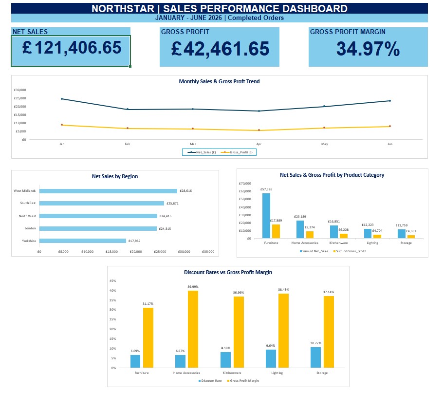

# Northstar Home & Living Ltd | Sales Performance Analysis

## Project Overview

This project analyses sales performance for Northstar Home & Living Ltd, a fictional UK retail business, covering January to June 2026.

The objective was to evaluate sales, profitability, regional performance, product categories and discounting, then provide practical recommendations to support management decisions.

**Tool used:** Microsoft Excel

## Business Questions

- How much revenue and gross profit did the business generate?
- Which regions and product categories performed best?
- How did sales change over the six-month period?
- How did discounting relate to profitability?
- What actions could management take to improve performance?

## Data Preparation and Analysis

The project involved:

- Checking and cleaning transaction records, including removing duplicates.
- Using XLOOKUP to retrieve product information.
- Calculating gross sales, discounts, net sales, costs, gross profit and profit margins.
- Excluding cancelled and returned orders from recognised sales and profit.
- Creating PivotTables and PivotCharts to analyse performance.
- Using GETPIVOTDATA to connect analysis results to dashboard KPIs.
- Developing an interactive-style Excel reporting dashboard and a management summary.

## Key Findings

**Overall performance**

- Net Sales: **£121,406.65**
- Gross Profit: **£42,461.65**
- Gross Profit Margin: **34.97%**

**Regional performance**

The West Midlands was the strongest-performing region by sales and gross profit, while Yorkshire recorded the lowest performance among the identified regions.

**Product performance**

Furniture generated the highest sales and gross profit but had the lowest profit margin among product categories. Home Accessories achieved the highest category profit margin.

**Monthly trends**

Sales generally declined between January and April, before recovering in May and June. The recovery was largely supported by increased quantities sold.

**Discount analysis**

Higher discount rates did not consistently correspond to lower gross profit margins across product categories, indicating that other factors, including product costs and pricing, also influence profitability.

## Business Recommendations

1. **Review Furniture profitability:** Investigate supplier costs, product pricing and individual product margins to identify opportunities for improvement.
2. **Investigate monthly sales fluctuations:** Examine additional historical data and consider how inventory planning and marketing activities could support more consistent performance.
3. **Explore growth opportunities in Yorkshire:** Investigate customer preferences and successful products in the region before developing targeted sales initiatives.

## Dashboard Preview

## Project Limitations

- Only Completed orders were included in recognised sales and profit.
- A transaction with an unknown region was included in company totals but excluded from regional comparisons.
- The dataset covers six months, limiting conclusions about seasonality or long-term performance.
- Additional customer, product and historical data would be needed to investigate the underlying causes of performance differences.

## Skills Demonstrated

Microsoft Excel · Data Cleaning · XLOOKUP · PivotTables · PivotCharts · GETPIVOTDATA · Financial Analysis · Dashboard Development · Business Insights · Management Reporting

## Project Files

- `Northstar_Excel_Project_1.xlsx` — Excel workbook containing the dataset, analysis, dashboard and management summary.
- `Northstar_dashboard.png` — Screenshot of the final dashboard.

*This is a fictional business analysis project created for learning and portfolio development.*
